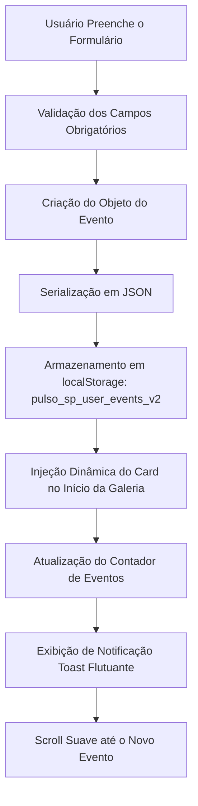

# PULSO SP — Guia Cultural Aberto de São Paulo

> **"A cidade acontece. Você só precisa encontrá-la."**

O **Pulso SP** é uma plataforma digital desenvolvida para democratizar o acesso de jovens à cultura em São Paulo, reunindo shows, exposições, festivais de rua, mostras de cinema, batalhas de rima, teatro independente e eventos de tecnologia e games com foco em opções **100% gratuitas ou de baixo custo**.

Construído com padrão visual editorial minimalista inspirado em estúdios premiados (nível *Awwwards / FWA*), o projeto une tipografia monumental, física de scroll fluida (*Lenis*), animações cinéticas via *GSAP 3 + ScrollTrigger*, cursor dinâmico com interpolação (*lerp*), sistema de filtros instantâneo sem recarregamento e persistência de eventos cadastrados pela comunidade com `localStorage`.

---

## 📋 Sumário para Desenvolvedores e Agentes de IA

1. [Visão Geral & Proposta de Valor](#-visão-geral--proposta-de-valor)
2. [Stack Tecnológica & Bibliotecas](#-stack-tecnológica--bibliotecas)
3. [Design System & Tokens](#-design-system--tokens)
4. [Arquitetura de Arquivos & Módulos](#-arquitetura-de-arquivos--módulos)
5. [Módulos JavaScript (ES Modules)](#-módulos-javascript-es-modules)
6. [Componentes & Seções da Interface](#-componentes--seções-da-interface)
7. [Fluxo de Dados & Persistência Local](#-fluxo-de-dados--persistência-local)
8. [Acessibilidade & Performance](#-acessibilidade--performance)
9. [Como Executar e Testar](#-como-executar-e-testar)
10. [Instruções de Deploy (GitHub Pages)](#-instruções-de-deploy-github-pages)

---

## 🎯 Visão Geral & Proposta de Valor

- **O Problema:** A cidade de São Paulo possui uma das maiores efervescências culturais do mundo, porém as informações sobre eventos independentes e gratuitos ficam amplamente dispersas em redes sociais, cartazes de rua e páginas isoladas.
- **A Solução:** Uma vitrine digital centralizada, visualmente refinada e com curadoria territorial (Centro, Zona Norte, Zona Sul, Zona Leste e Zona Oeste), onde jovens encontram lazer cultural de forma rápida, filtrando por gratuidade, gênero e proximidade.
- **Participação Comunitária:** Produtores e coletivos podem cadastrar novos eventos através de um formulário funcional direto no navegador.

---

## 🛠️ Stack Tecnológica & Bibliotecas

- **HTML5 Semântico:** Marcação acessível estruturada com tags semânticas (`<main>`, `<header>`, `<nav>`, `<section>`, `<article>`, `<footer>`, `<aside>`).
- **CSS3 Moderno:** Design tokens nativos com CSS Custom Properties, layout 100% responsivo com CSS Grid e Flexbox, funções matemáticas `clamp()`, `min()` e `calc()`, transições por GPU (`transform`, `opacity`, `clip-path`).
- **JavaScript ES Modules (Vanilla):** Sem dependência de jQuery ou frameworks pesados. Código modular, puro e orientado a eventos.
- **Lenis 1.1.18:** Smooth scroll vertical de alta precisão com interpolação e aceleração inercial.
- **GSAP 3.12.5 + ScrollTrigger:** Orquestração de animações baseadas no scroll, efeito de reveal por máscara, paralaxe em imagens e divisores hairline.

---

## 🎨 Design System & Tokens

Definidos globalmente em [css/style.css](file:///c:/Users/26012129/Documents/GitHub/RossetiSite/css/style.css):

| Token CSS | Valor | Descrição |
| :--- | :--- | :--- |
| `--bg` | `#F4F3EF` | Fundo editorial *Off-White* suíço de alto contraste |
| `--bg-dark` | `#0A0A0A` | Preto profundo arquitetônico para seções imersivas |
| `--fg` | `#0A0A0A` | Cor tipográfica primária |
| `--fg-light` | `#F4F3EF` | Cor tipográfica clara sobre fundos escuros |
| `--muted` | `#7E7D7A` | Cinza neutro para metadados e legendas |
| `--border` | `rgba(10, 10, 10, 0.12)` | Hairline dividers sutis de 1px |
| `--accent` | `#E90F15` | Vermelho Editorial Internacional (*Pulse Red*) |
| `--font-display` | `'Space Grotesk', sans-serif` | Tipografia geométrica monumental para títulos (pesos 500/700) |
| `--font-body` | `'Inter', sans-serif` | Tipografia editorial neutra para corpo e metadados (pesos 300/400/500/600) |
| `--gutter` | `clamp(16px, 4vw, 64px)` | Margem lateral generosa e fluida |

---

## 📁 Arquitetura de Arquivos & Módulos

```text
RossetiSite/
├── index.html                      # Aplicação web completa do Pulso SP
├── cidade.html                     # Guia editorial “Viva a Cidade” por região
├── README.md                       # Documentação técnica e conceitual
├── .nojekyll                       # Desativa processamento Jekyll no GitHub Pages
├── .github/
│   └── workflows/
│       └── deploy.yml              # Pipeline de deploy automático para GitHub Pages
├── css/
│   └── style.css                   # Folha de estilos central e design system
├── js/
│   ├── main.js                     # Orquestrador central da aplicação
│   ├── smooth-scroll.js            # Integração Lenis + GSAP ticker + navbar inteligente
│   ├── cursor.js                   # Cursor cinético com lerp physics e labels contextuais
│   ├── marquee.js                  # Letreiros infinitos reativos à velocidade do scroll
│   ├── menu.js                     # Menu fullscreen editorial, roll text e focus trap
│   ├── preloader.js                # Contador 0-100% numérico e revelação em cortina
│   ├── reveal.js                   # ScrollTrigger reveals, clip-path e paralaxe interno
│   └── events.js                   # Motor de filtros, busca e persistência com localStorage
└── assets/
    └── pulso/                      # Recursos visuais locais otimizados
        ├── festival-sp.webp        # Foto de alta resolução de festival no Villa-Lobos
        ├── arte-imersiva.webp      # Foto de instalação imersiva no MIS
        ├── cinema-performance.webp # Foto de mostra na Praça Roosevelt
        ├── tecnologia-games.webp   # Foto de encontro tech/games no CCSP
        └── favicon.svg             # Favicon com o ponto pulsante vermelho
```

---

## ⚙️ Módulos JavaScript (ES Modules)

### 1. `js/main.js`
Ponto de entrada (`DOMContentLoaded`). Inicializa os subsistemas na ordem necessária:
1. `initCursor()`
2. `initSmoothScroll()`
3. `initMenu()`
4. `initMarquees()`
5. `initEvents()`
6. `initPreloader(() => initReveals())`

### 2. `js/smooth-scroll.js`
- Inicializa o **Lenis** com easing `expo.out` e sincroniza o seu ciclo com o ticker global do GSAP (`gsap.ticker.add((time) => lenis.raf(time * 1000))`).
- **Navbar Inteligente:** Monitora a posição de rolagem (`scroll > 50px`) e injeta a classe `.is-scrolled` no `.site-header`, ativando o fundo fosco *frosted glass* (`backdrop-filter: blur(20px)`), isolando o logo e impedindo colisões com textos da página.
- Conecta o botão *"Voltar ao topo"* com animação suave de 1.5s.
- Exporta métodos `stopScroll()` e `resumeScroll()` para travar o body quando o menu estiver aberto.

### 3. `js/cursor.js`
- Desativado automaticamente em telas touch (`(pointer: coarse)`).
- Interpola a posição do ponteiro com física *lerp* de fator `0.15` em loop `requestAnimationFrame`.
- Detecta atributos `[data-cursor="Texto"]` nos elementos e expande a cápsula exibindo rótulos dinâmicos (`Ver Evento`, `Explorar`, `Divulgar`, `Destaque`).

### 4. `js/marquee.js`
- Suporta múltiplos letreiros infinitos na página.
- Duplica automaticamente os nós filhos para garantir loop sem lacunas (*gapless wrap*).
- Monitora a velocidade e a direção do scroll: ao rolar rápido, o letreiro acelera proporcionalmente; ao rolar para cima, a direção inverte suavemente.

### 5. `js/menu.js`
- Abre e fecha o painel fullscreen com transição `clip-path: inset(...)` em easing `expo.inOut`.
- Efeito *roll text*: links possuem texto duplicado empilhado verticalmente; no hover, o original sobe e o clone vermelho entra por baixo.
- Ao passar o mouse sobre um item do menu, os demais sofrem dimming para opacidade `0.28`.
- Inclui controle de acessibilidade: trava de foco (*Focus Trap* com tecla Tab) e fechamento pela tecla `Escape`.

### 6. `js/preloader.js`
- Contador numérico progressivo de 0 a 100% em cada carregamento completo da página.
- Revelação da página com cortina deslizante via `clip-path: inset(0 0 100% 0)`; cortina, título `PULSO SP` e subtítulo compartilham a mesma timeline GSAP, easing e duração.
- Não usa `sessionStorage` para suprimir o preloader em recarregamentos posteriores.

### 7. `js/reveal.js`
- Registra os gatilhos do **GSAP ScrollTrigger**:
  - Revelação de títulos hero com máscaras de overflow (`yPercent: 125 -> 0`).
  - Paralaxe na imagem hero (`scale: 1.12 -> 1.0` e `yPercent: -6 -> 8`).
  - Divisores hairline com animação da esquerda para a direita (`scaleX: 0 -> 1`).
  - Cards da galeria com entrada em `clip-path: inset(100% 0 0 0) -> inset(0)` e paralaxe interno na imagem.
- Respeita `prefers-reduced-motion: reduce`, desativando movimentos caso o usuário prefira.

### 8. `js/events.js`
- Gerencia a lista de cards de eventos e executa a filtragem dinâmica em memória sem recarregar a página.
- **Filtros combináveis:** Categoria (Música, Cinema, Teatro, Exposições, Cultura Urbana, Tecnologia & Games) + Preço (todos ou apenas 100% gratuitos) + Região geográfica.
- Inicializa a região a partir do parâmetro `?regiao=` usado pelos links do guia `cidade.html`.
- **Submissão Comunitária:** Coleta os campos do formulário `#submit-event-form`, valida, armazena no `localStorage` sob a chave `pulso_sp_user_events_v2`, renderiza o novo card no topo da grade com selo `• NOVO`, emite notificação flutuante (*toast*) e rola a tela até o novo evento.

---

## 🏛️ Componentes & Seções da Interface

### 1. Header Fixo
- Esquerda: Identificação `PULSO SP` com ponto vermelho pulsante (`.pulse-dot`).
- Direita: Botão de menu hambúrguer de duas linhas que se transformam em "X".
- Isolamento: Fundo translúcido com *backdrop-filter* ao rolar, evitando qualquer sobreposição visual.

### 2. Capa (Hero)
- Título monumental em *mask reveal*: `PULSO` (sólido) e `SP` (outline vazado).
- Slogan e subtítulo em faixa superior.
- Letreiro infinito outline de alta velocidade reativo ao scroll.
- Fotografia cinematográfica em tela cheia (100vw × 100vh) com paralaxe e indicador de rolagem.

### 3. Overview (O Manifesto)
- Grid assimétrico de 12 colunas com o problema real resolvido e os pilares de democratização cultural.
- 3 colunas de metadados com divisores hairline animados.

### 4. Galeria de Próximos Eventos (As 5 Composições Monumentais)
- **Barra de Filtros Editoriais:** Botões com design arquitetônico, micro-bordas nítidas, zero emojis e indicador especial para eventos gratuitos.
- **Composição 1 (Full-width Landscape):** 100vw × 85vh (*Festival Cidade Viva*).
- **Composição 2 (Dual Tablets Assimétricos):** Dois tablets verticais com queda assimétrica de 140px no segundo card (*Mostra Cinema na Rua* e *Futuros Ancestrais*).
- **Letreiro Gigante Intermediário:** Faixa preta imersiva de 100vw (*"CULTURA URBANA • OCUPA SÃO PAULO • "*).
- **Composição 3 (Collage Grid Irregular):** Card de destaque span 7 e card lateral span 5 (*Batalha do Vale* e *SP Tech Fest*).
- **Composição 4 (Triple Phones em Cascata):** Três celulares de 720px com degraus verticais de 0, 90px e 180px (*Teatro no Bixiga*, *Feira de Zines* e *Jazz na Escadaria*).
- **Composição 5 (Landscape Contido):** Panorama cinematográfico de 800px (*Sinfônica no Ibirapuera*).

### 5. Categorias
- Grid editorial com os 7 gêneros culturais; ao clicar, ativa o filtro e rola suavemente para os eventos correspondentes.

### 6. Evento da Semana (Destaque em Tela Inteira)
- Bloco monumental com foto do Vale do Anhangabaú, tipografia gigante e botão de ação direta.

### 7. "Perto de Você" (Regiões da Capital)
- Seletor estilizado das 5 zonas (Centro, Norte, Sul, Leste e Oeste) que filtra instantaneamente os eventos da localidade escolhida.

### 8. Envie um Evento
- Formulário minimalista de duas colunas com campos de Nome, Data, Local, Região, Categoria, Preço, Classificação e Descrição.

### 9. Next Project / Portal
- Letreiro monumental em tela cheia que inverte a cor no hover (preto para off-white) e abre `cidade.html` com transição de cortina.
- O guia “Viva a Cidade” apresenta Centro e as quatro zonas; cada território abre `index.html?regiao=<slug>#eventos` com a agenda filtrada para a região selecionada.

### 10. Rodapé Minimalista
- Tipografia escultural `Pulso SP`, slogan oficial, direitos autorais e botão *"Voltar ao topo ↑"*.

---

## 💾 Fluxo de Dados & Persistência Local



---

## ♿ Acessibilidade & Performance

- **`prefers-reduced-motion`:** Detectado via media query e em JavaScript; quando ativo, desativa marquees infinitos, remove paralaxe, exibe todos os elementos instantaneamente sem clip-path e usa scroll nativo instantâneo.
- **Navegação por Teclado:** Foco visível com contorno em `--accent` (`:focus-visible`), suporte total a navegação por tabulação e tecla `Escape` no menu.
- **Otimização de Imagens:** Recursos visuais formatados em WebP, com atributos `width`, `height`, `loading="lazy"` e `decoding="async"`, prevenindo Layout Shift (CLS zero).
- **Padrão Lighthouse:** Otimizado para pontuação 90+ em Performance, Acessibilidade e Melhores Práticas.

---

## 🚀 Como Executar e Testar

Como o projeto é construído em Vanilla HTML5, CSS3 e ES Modules puros, não requer etapa de build (`npm build`) ou instalação de dependências:

1. Clone o repositório ou acesse a pasta do projeto:
   ```bash
   cd RossetiSite
   ```

2. Inicie qualquer servidor HTTP estático local:
   ```bash
   # Com Python 3
   python -m http.server 8085
   ```

3. Abra o navegador em:
   - **Plataforma Pulso SP:** [http://localhost:8085/](http://localhost:8085/)
   - **Guia Viva a Cidade:** [http://localhost:8085/cidade.html](http://localhost:8085/cidade.html)

---

## 🌐 Instruções de Deploy (GitHub Pages)

O repositório já está configurado para publicação automática:
- O arquivo `.nojekyll` na raiz desativa o processamento do Jekyll pelo GitHub.
- A cada `git push origin main`, a GitHub Action em `.github/workflows/deploy.yml` compila e entrega a versão estática diretamente no GitHub Pages:
  - **URL de Produção:** [https://carlos2511760-blip.github.io/RossetiSite/](https://carlos2511760-blip.github.io/RossetiSite/)
